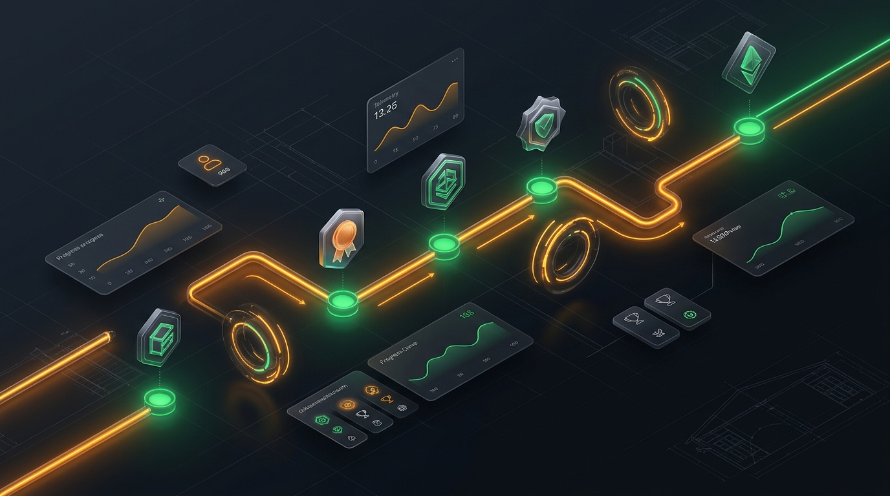
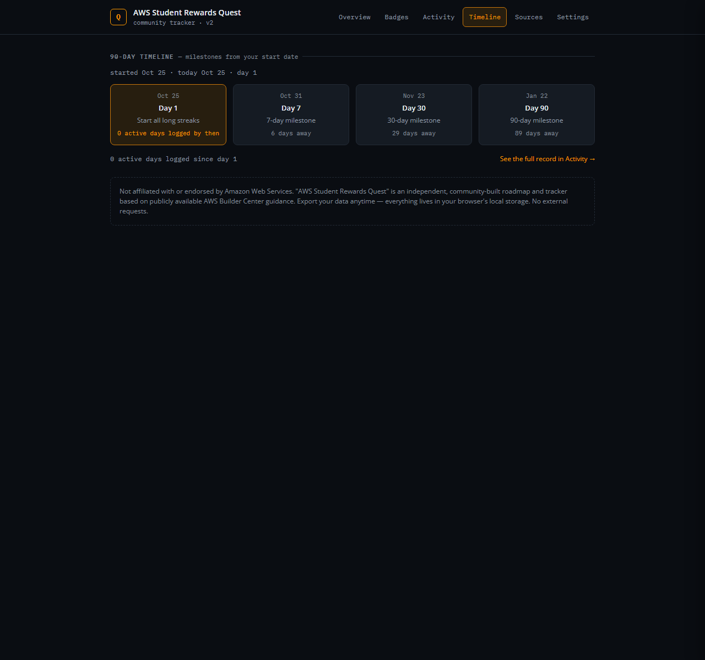

<div align="center">



# AWS Student Rewards Quest
### The Local-First 90-Day Roadmap & Habit Engine for AWS Builder Center

**Turn scattered badges, fragile 90-day streaks, and opaque requirements into an actionable daily quest.**

[Explore Live Demo →](https://sebajuarez.github.io/aws-student-rewards-quest/) · [The Problem](#the-problem-why-students-fail-to-complete-student-rewards) · [The Solution](#the-solution-a-deterministic-daily-quest-engine) · [Features](#key-capabilities--product-tour) · [Quick Start](#quick-start--local-setup)

<br/>

[](#)
[-blue?style=flat-square)](#)
[-green?style=flat-square)](#)
[](#)
[](#)

</div>

> **Notice & Disclaimer:** This is an independent, community-built tracker and roadmap based on publicly available AWS Builder Center guidance. It is **not** affiliated with, endorsed by, or sponsored by Amazon Web Services, Inc.

---

## The Problem: Why Students Fail to Complete Student Rewards

The **AWS Builder Center Student Rewards** program offers high-value career catalysts for university students — including **$30 in AWS Cloud Credits**, **12 months of AWS Skill Builder Premium**, and a **$100 AWS Foundational Certification Exam Voucher**.

Yet, the vast majority of students who register never claim the certification voucher due to four structural friction points:

1. **Streak Fragility & Silent Resets**
   The program requires maintaining 7, 30, and 90-day continuous daily streaks (sign-ins, likes, comments) and 4-week weekly publishing cycles. Missing a single local day or Sunday window quietly resets a months-long streak back to zero with zero advance warning from AWS.
2. **Opaque, Fragmented Requirements**
   AWS confirms that 21 badges exist, but the exact actions, prerequisites, and evaluation criteria are scattered across community blog posts, author guides, and forum discussions. Students are left guessing what actually triggers an unlock.
3. **Daily Decision Paralysis ("What should I do today?")**
   Without a sequenced roadmap, students complete easy one-time badges in their first week, but fail to start the mandatory 90-day daily runways on Day 1. By the time they realize a badge requires 90 consecutive days, their academic semester has passed.
4. **Tool Bloat & Privacy Concerns**
   Students shouldn't have to give third-party cloud backends access to their Builder Center accounts, install shady extensions, or risk telemetry leaks just to track simple habit progress.

---

## The Solution: A Deterministic Daily Quest Engine

**AWS Student Rewards Quest** transforms the 21 badges into an interactive, local-first progression system. It eliminates ambiguity and protects your streaks with deterministic rules:

### 1. Today's Quest — Prioritized Action Queue
Never wonder what to do next. The rule engine ranks the 3–5 highest-leverage actions for today using strict priority tiers:
- **At-Risk Daily Streaks (Priority 100)**: Active streaks about to lapse before local midnight.
- **90-Day Runway Starters (Priority 90)**: Long-duration commitments that must be started immediately to finish on time.
- **Weekly Window Actions (Priority 80)**: Weekly wish voting and article drafting before the Sunday cutoff.
- **Quick Wins & Community Badges (Priority 70–60)**: Actionable 5-minute profile tasks.

Each action displays exact estimated minutes, requirement context, and direct 1-tap logging buttons.

### 2. Zero-Loss Habit Tracking with Instant Undo
- **Quick Log Bar**: Record your daily sign-in, like, or comment habit in less than 2 seconds right from the dashboard.
- **In-Memory Safety Undo**: Made a mistake or clicked the wrong button? Instant 1-level rollback via toast notifications.
- **Continuous Streak Engine**: Streaks are modeled as unified counters — 7, 30, and 90-day milestones unlock seamlessly from the same counter without duplicate tracking.

### 3. 90-Day Interactive Activity Heatmap & Personal Records
- Visual 90-day contribution matrix showing daily activity, streak health, and upcoming milestones.
- Proactive risk states: cells highlight in warning orange when a live streak needs attention today, avoiding false "streak lost" alarms while the deadline is still open.
- Touch-optimized targets (26px tap targets) and full keyboard navigation (arrow keys + roving tabindex).
- Personal records summary card tracking your best daily streaks and most active weeks.

### 4. 21-Badge Catalog with Fast Search & Direct Actions
- Instantly filter badges by status (*Available, Active, Completed, Locked*) or Phase (*Foundation, Daily Engagement, Community Contributor, etc.*).
- Real-time instant search across badge titles, official numbers, and paraphrased requirements.
- URL hash synchronization (`#/badges?q=article&phase=Community`) so search views are directly shareable and bookmarkable.

### 5. Strict Source Integrity & Drawer Transparency
Every badge detail drawer strictly separates 4 distinct layers:
- **AWS Official Fact**: Confirmed per-badge requirement (or a prominent *Verification Needed* warning if AWS has not officially published exact wording).
- **Community Synthesis**: Paraphrased requirements from vetted AWS community builders with dedicated *View Source* citations.
- **Recommended Path**: Strategy advice and day-1 tips.
- **Your Progress**: Local completion status, personal overrides, and custom notes.

### 6. 100% Local-First, Private & Offline
- **Zero Server & Zero Telemetry**: All data stays in your browser's `localStorage`. No logins, no tracking, no external network requests.
- **Calendar Reminders Export (.ics)**: Download standard iCalendar files with daily habit reminders and projected milestone alerts directly to Google Calendar, Apple Calendar, or Outlook.
- **PWA Ready**: Offline Service Worker caching and Web App Manifest allow you to install it as a standalone desktop or mobile application.
- **Full Portability**: Instant JSON export and schema-validated import with safety rollback.

---

## Key Capabilities & Product Tour

| **Dashboard & Today's Quest** | **21 Badges Catalog & Search** |
|:---:|:---:|
|  |  |
| *Actionable Today's Quest, Quick Log bar, streak alerts, and rewards progress.* | *Live search, phase filters, sorting, and inline badge actions.* |

| **Activity Heatmap & Personal Records** | **Transparent Badge Drawer & Citations** |
|:---:|:---:|
|  |  |
| *90-day activity matrix, keyboard navigation, and historical log.* | *Official AWS facts vs community synthesis with per-source citations.* |

| **90-Day Milestone Timeline** | **Mobile Experience** |
|:---:|:---:|
|  |  |
| *Day 1, 7, 30, and 90 milestone dates projected from your actual start date.* | *Fully responsive PWA layout with mobile navigation scroller.* |

---

## Reward Milestones

The roadmap maps directly to the official AWS Student Rewards tier payout:

| Badges Completed | Official AWS Reward | Tracker Capability |
|:---:|---|---|
| **7 Badges** | **$10 AWS Credits** | Calculates milestone projection date based on active habits |
| **14 Badges** | **+$20 AWS Credits** | Tracks runway gaps and highlights unlocked intermediate badges |
| **21 Badges** | **$100 AWS Certification Voucher** (Foundational) | Full 90-day endgame projection and completion celebration |

---

## Architecture & Design Principles

- **Zero Build Step, Zero Dependencies**: Pure HTML5, modern CSS3 (custom properties design tokens, container layouts), and native ES Modules (`src/`).
- **Deterministic Domain Layer**: Clean separation between pure business logic (`src/domain/`) and view presentation (`src/ui/`).
- **Resilient Storage Migration**: Versioned schema migrations (`v1 → v2 → v3`) ensure user data is never lost across app upgrades.
- **Self-Contained & Privacy Compliant**: Self-hosted WOFF2 fonts (Open Sans & IBM Plex Mono) without external Google Fonts or CDN requests.
- **Accessibility & Keyboard-First**: WCAG AA color contrast, `<dialog>` modals with focus traps, ARIA live announcements, and global shortcuts.

```
src/
├── app.js               # Application entry point, router initialization & SW registration
├── data/                # Static catalog (badges, sources, reward tiers)
├── domain/              # Pure domain logic (store, dates, activity log, quest engine, calendar)
├── ui/                  # UI components, hash router, render engine, modals, drawer, celebrations
├── styles/              # Design tokens, base styles, layout, components, responsive rules
└── fonts/               # Self-hosted WOFF2 typography (Open Sans & IBM Plex Mono)
```

---

## Quick Start & Local Setup

Because the application uses native JavaScript ES Modules, browsers require it to be served over standard HTTP/HTTPS (opening `index.html` directly via `file://` will trigger browser CORS module security restrictions).

### Prerequisites
- Node.js (v18+) **or** Python (3.x) **or** any static web server.

### 1. Clone the repository
```bash
git clone https://github.com/SebaJuarez/aws-student-rewards-quest.git
cd aws-student-rewards-quest
```

### 2. Start a local server
Run any of the following commands:

**Using Node (npx):**
```bash
npx serve .
```

**Using Python:**
```bash
python -m http.server 8080
```

**Using VS Code:**
Install the *Live Server* extension and click **"Go Live"** on `index.html`.

### 3. Open in your browser
Navigate to `http://localhost:8080` (or the URL printed by your server) to start your quest.

### Running Automated Tests
The repository includes a comprehensive, dependency-free test suite using Node's native test runner:
```bash
npm test
```
All 154 unit tests run in less than a second, validating streak calculations, activity normalization, quest ranking rules, calendar export, and data migration.

---

## Keyboard Shortcuts

Press `?` anywhere in the app to open the keyboard cheat sheet:

| Key | Action |
|:---:|---|
| <kbd>1</kbd> – <kbd>6</kbd> | Instant navigation across views (Overview, Badges, Activity, Timeline, Sources, Settings) |
| <kbd>L</kbd> | Jump focus to the next available Quick Log action |
| <kbd>←</kbd> / <kbd>→</kbd> | Navigate to previous / next badge while the detail drawer is open |
| <kbd>↑</kbd> <kbd>↓</kbd> <kbd>←</kbd> <kbd>→</kbd> | Navigate days inside the 90-day activity heatmap |
| <kbd>Esc</kbd> | Close active drawer, modal, or cheat sheet |
| <kbd>?</kbd> | Open keyboard shortcuts modal |

---

## Disclaimer

**AWS Student Rewards Quest** is an independent, community-built roadmap and tracker. It is not affiliated with, endorsed by, or sponsored by Amazon Web Services, Inc. 

"AWS", the AWS logo, "AWS Builder Center", and "AWS Skill Builder" are trademarks of Amazon.com, Inc. or its affiliates. Reward requirements and program terms are subject to change by AWS — always verify on the official [AWS Builder Center](https://builder.aws.com/) portal before redeeming rewards.
