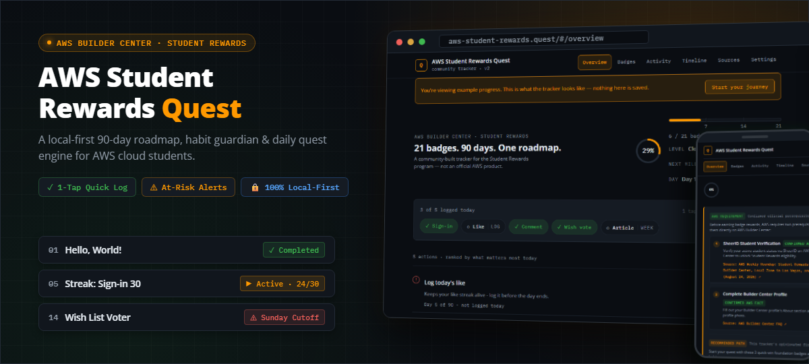
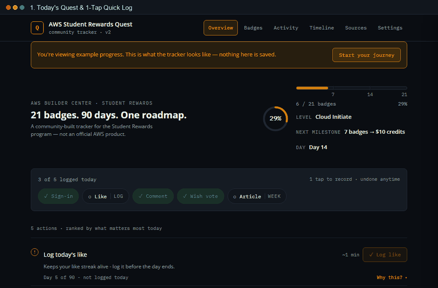

<div align="center">



# AWS Student Rewards Quest
### The Local-First 90-Day Roadmap & Habit Engine for AWS Builder Center

**Turn scattered badges, fragile 90-day streaks, and opaque requirements into an actionable daily quest.**

[🚀 Explore Live Demo](https://sebajuarez.github.io/aws-student-rewards-quest/) · [⚡ Quick Start](#quick-start--local-setup) · [🎯 Problem & Solution](#the-problem--the-solution)

<br/>

[](#)
[-blue?style=flat-square)](#)
[-green?style=flat-square)](#)
[](#)
[](#)

</div>

> **Notice:** An independent, community-built tracker based on public AWS Builder Center guidance. **Not affiliated with, endorsed by, or sponsored by Amazon Web Services, Inc.**

---

## The Problem & The Solution

The **AWS Builder Center Student Rewards** program grants real career rewards — including **$30 in AWS Credits**, **12 months of Skill Builder Premium**, and a **$100 AWS Certification Voucher**.

Yet, most students fail to complete the 21 badges due to three critical roadblocks:

| The Problem | How AWS Student Rewards Quest Solves It |
|---|---|
| **Fragile 90-Day Streaks**<br>Missing a single local day or Sunday cut-off quietly resets a 90-day streak to zero without warning. | **Proactive At-Risk Alerts**<br>Surfaces live streaks at risk before local midnight and flags weekly cutoffs with countdown deadlines. |
| **Opaque, Dispersed Requirements**<br>AWS confirms 21 badges exist, but exact criteria and checklists are buried across community blogs. | **Verified Source Citations**<br>Every badge drawer strictly separates official AWS facts, community-synthesized requirements, and verified source links. |
| **Daily Decision Paralysis**<br>Students start 90-day daily commitments too late or don't know what to do on Day 1. | **Deterministic Today's Quest Engine**<br>Ranks the top 3–5 highest-leverage actions for today (At-risk first → Long runways second → Quick wins third). |

---

## Product Demo

<div align="center">



*From daily logging and habit alerts to badge search, source citations, and the 90-day activity heatmap.*

</div>

---

## Core Capabilities

- ⚡ **1-Tap Quick Log & In-Memory Undo:** Log daily sign-in, like, or comment habits in 2 seconds directly from the header, with instant rollback.
- 🎯 **Actionable Today's Quest:** Deterministic priority queue ranking daily actions with estimated minutes and direct action buttons.
- 🔍 **21-Badge Catalog & Live Search:** Instant search by name, number, or requirement with status filters (`Available`, `Active`, `Completed`, `Locked`) and shareable URL queries.
- 📅 **90-Day Heatmap & Calendar Export:** Interactive GitHub-style activity matrix with touch targets and downloadable RFC 5545 `.ics` calendar reminders.
- 🔒 **100% Local-First & Offline (PWA):** Zero accounts, zero tracking, zero external network requests. Data stays in your browser with full JSON export/import.

<br/>

| **Actionable Dashboard** | **Transparent Drawer & Sources** |
|:---:|:---:|
|  |  |
| *Progress ring, 1-tap Quick Log, Today's Quest & At-Risk strip.* | *Official AWS facts vs community synthesis with "View source" citations.* |

---

## Quick Start & Local Setup

Because the app is built with native JavaScript ES Modules (zero bundlers, zero dependencies), browsers require it to be served over standard HTTP:

```bash
# 1. Clone the repository
git clone https://github.com/SebaJuarez/aws-student-rewards-quest.git
cd aws-student-rewards-quest

# 2. Run a local server (any of these)
npx serve .               # Node.js
python -m http.server     # Python 3
# Or right-click index.html -> "Open with Live Server" in VS Code

# 3. Open in your browser
# Navigate to http://localhost:3000 (or the printed port)
```

### Running Automated Tests
```bash
npm test
```
Runs all 154 unit tests via Node's native test runner (sub-second execution, zero dependencies).

---

## Keyboard Shortcuts

Press <kbd>?</kbd> anywhere in the app to open the shortcut cheat sheet:
- <kbd>1</kbd>–<kbd>6</kbd>: Jump between views (*Overview, Badges, Activity, Timeline, Sources, Settings*)
- <kbd>L</kbd>: Jump focus to the next available Quick Log action
- <kbd>←</kbd> / <kbd>→</kbd>: Navigate badges inside the detail drawer
- <kbd>↑</kbd> <kbd>↓</kbd> <kbd>←</kbd> <kbd>→</kbd>: Navigate days inside the 90-day activity heatmap
- <kbd>Esc</kbd>: Close drawer or modal

---

## Disclaimer

**AWS Student Rewards Quest** is an independent, community-built roadmap and tracker. It is not affiliated with, endorsed by, or sponsored by Amazon Web Services, Inc. 

"AWS", "AWS Builder Center", and "AWS Skill Builder" are trademarks of Amazon.com, Inc. or its affiliates. Reward requirements are subject to change by AWS — always verify on the official [AWS Builder Center](https://builder.aws.com/) portal before redeeming rewards.
