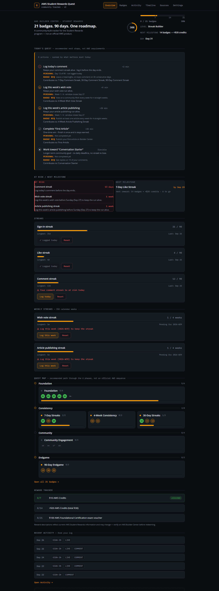
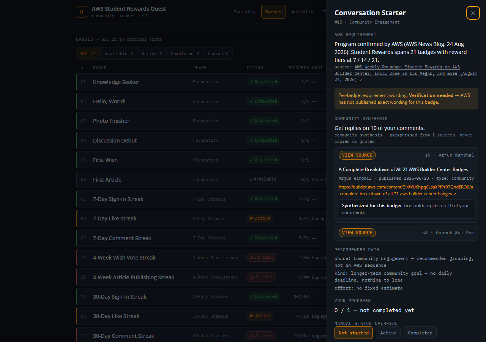
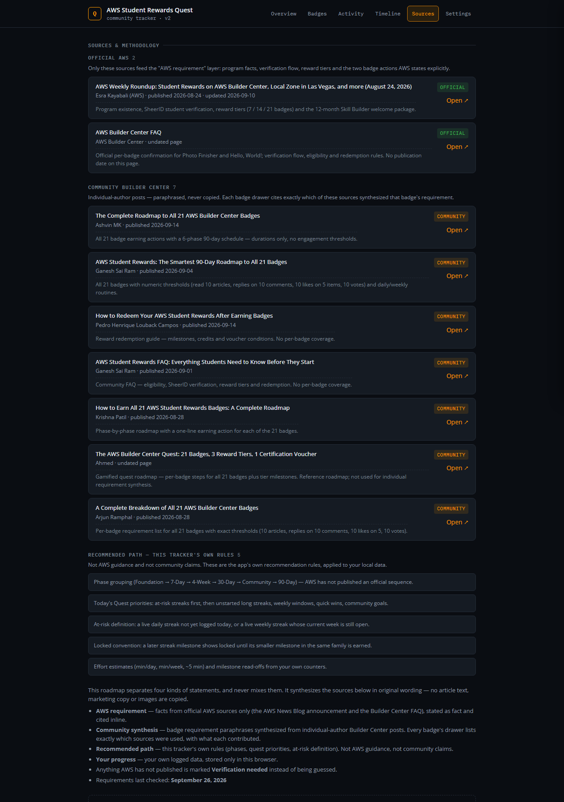
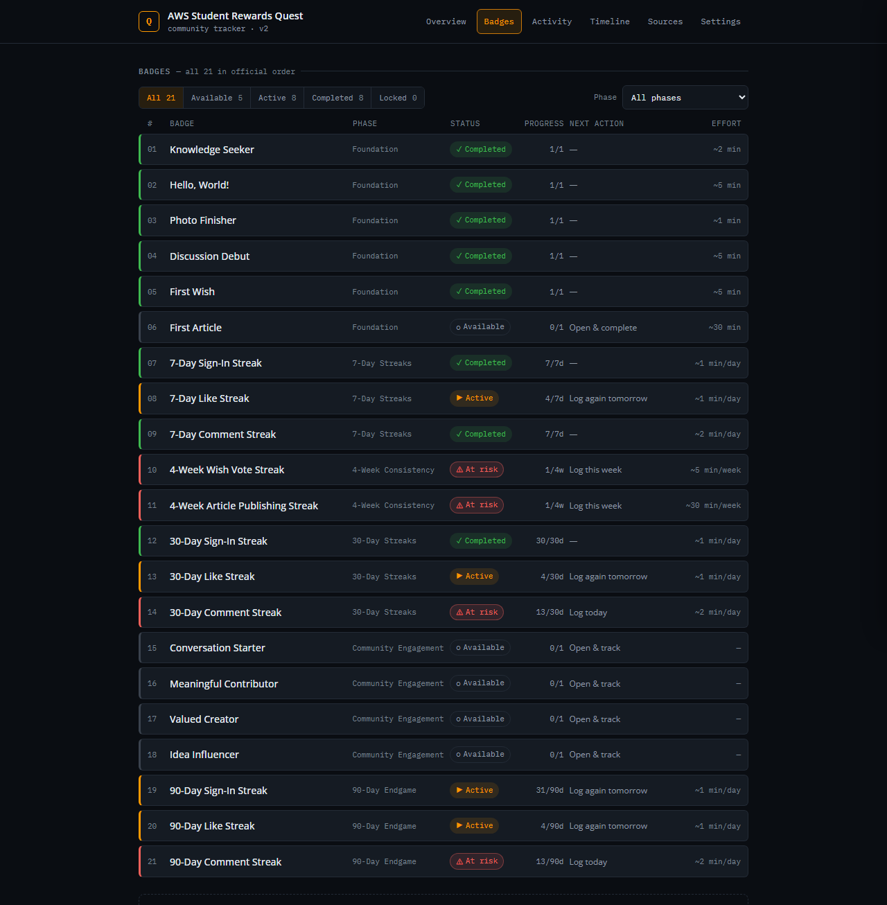
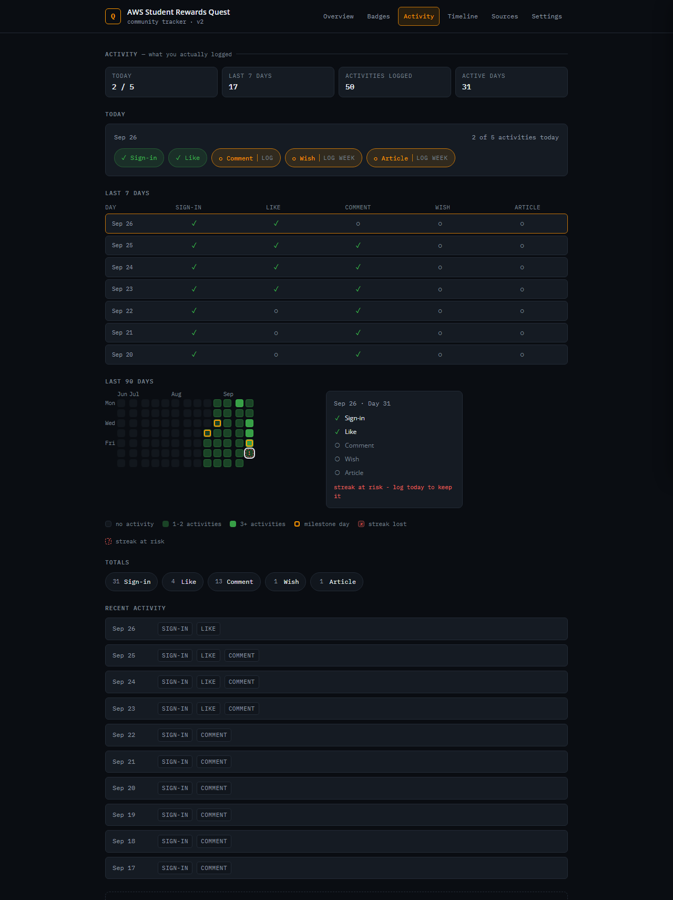
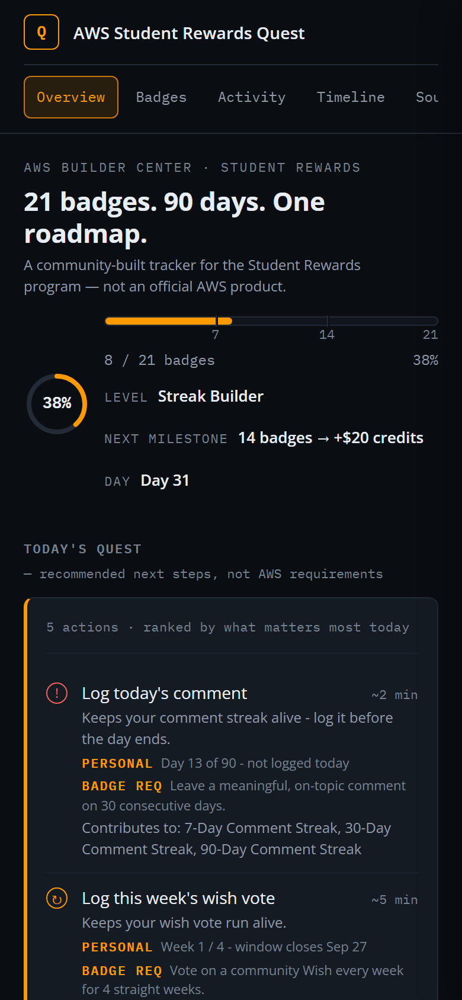

# AWS Student Rewards Quest

A local-first, gamified roadmap and tracker for the 21 badges in AWS Builder Center's
**Student Rewards** program — built to answer one question at a glance: *where am I, what
can I do today, what unlocks next, and what am I at risk of losing?*

> **Not affiliated with or endorsed by Amazon Web Services.** This is an independent,
> community-built tracker based on publicly available AWS Builder Center guidance.

**[Live demo →](https://sebajuarez.github.io/aws-student-rewards-quest/)**

   

---

## Screenshots

**Overview** — where you are, what's at risk, what to do today:



**Badge detail drawer** — the AWS requirement (with a *Verification needed* note when AWS
hasn't published exact wording), the community synthesis with a **View source** row per
cited source, the recommended path, your progress, and your notes:



**Sources & methodology** — official AWS sources, community sources (each labeled with
what it was used for), and this tracker's own recommendation rules, kept apart:



**Badges** — all 21, filterable by status and phase:



**Activity** — today's log, the last 7 days, a 90-day heatmap:



**Mobile**:



## What it does

- Six in-app views, navigated from the header — **Overview**, **Badges**, **Activity**,
  **Timeline**, **Sources**, **Settings** (hash routes like `#/badges`, so any view is
  linkable and the browser back button works).
- **Overview** answers the four questions at a glance: your level and milestone, Today's
  Quest, what's at risk right now, and what's next.
- Tracks progress on all 21 Student Rewards badges — `X / 21`, by phase, with real names and
  paraphrased requirement summaries.
- **Today's Quest**: computes the 3–5 highest-value actions to take right now (streaks at
  risk first, then long-duration streaks worth starting on day 1, then quick wins), with an
  explicit **AT RISK** block for whatever you can still lose before the day or the week closes.
- **Badges**: a dense, filterable list (available / in progress / completed / locked, by
  phase); the detail drawer keeps four layers strictly separate — the **AWS requirement**
  (official facts or a *Verification needed* note), the **community synthesis** (the
  paraphrased requirement plus a *View source* row showing exactly which sources fed it),
  the **recommended path**, and **your progress** with overrides and notes.
- **Activity**: today's log, the last 7 days, a 90-day heatmap and recent entries —
  the day-by-day record of truth that streaks and weeks are rebuilt from.
- **Streaks**: sign-in, like, and comment activity tracked as continuous counters, with the
  7 / 30 / 90-day badges read off the same counter as milestones.
- **90-day timeline**: dynamically calculated Day 1 / 7 / 30 / 90 markers from your actual
  start date, with active days logged by each milestone.
- **Reward tracker**: 7 badges → $10 AWS Credits, 14 badges → +$20 credits, 21 badges → $100
  AWS Foundational Certification exam voucher (confirmed against the official AWS News Blog
  announcement).
- **Sources & methodology**: every source listed with author, date, link, and what it was
  used for, split into *Official AWS*, *Community Builder Center*, and this tracker's own
  rules — plus a *Requirements last checked* date.
- **Personal / Community mode**: Community Mode is a read-only demo — logging, reset and
  import are disabled there so example progress can never mix with your own. Per-badge
  status overrides, per-badge notes, export/import as JSON, storage info, and a full reset
  live in Settings. Everything stays in your browser's `localStorage`: no account, no
  server, no data leaves your machine.

## Why it exists

AWS's own program page tells you *that* the badges exist. It doesn't tell you which ones to
start on day one, which streaks quietly reset your progress if you miss a day, or how the
first 6 quick-win badges relate to the 90-day endgame. This tool turns that into an actual
plan.

## How this roadmap was built

Four kinds of statements, never mixed:

1. **AWS requirement** — facts from official AWS sources only (the AWS News Blog
   announcement and the AWS Builder Center FAQ), stated as fact and cited inline. Anything
   AWS has not published is marked **Verification needed** instead of being guessed.
2. **Community synthesis** — every badge requirement is an original paraphrase synthesized
   from individual-author Builder Center posts. Each badge's drawer lists exactly which
   sources were used and what each one contributed.
3. **Recommended path** — this tracker's own rules (phase grouping, Today's Quest
   priorities, at-risk definition). Not AWS guidance, and not community claims.
4. **Your progress** — your own logged data only, stored locally in your browser.

No article text, marketing copy, or images are copied from any source. The requirement
wording is re-checked periodically; the current pass is dated in the app under
**Sources → Requirements last checked**.

## Tech stack

HTML, CSS, and vanilla JavaScript as native ES modules — no build step, no framework, no
dependencies besides a Google Fonts request (Open Sans / IBM Plex Mono). The code lives
in small, single-purpose modules under `src/` and ships as plain static files, so it runs
anywhere that serves static files: a static host, GitHub Pages, or a local server. See
[`AGENTS.md`](./AGENTS.md) for the full rationale, folder conventions, data model, and refactor
path if you want to move it to a component framework later.

```
src/
├── app.js        # entry point: wires events, boots the hash router, triggers the first render
├── data/         # static catalog: badges + phases, sources, reward tiers
├── domain/       # DOM-free logic: store (localStorage), status rules, activity, quest engine
├── ui/           # router (hash → view), render orchestrator, one file per view, drawer, events
└── styles/       # design tokens, base, layout, components, overlays, responsive
```

## Running it

There's nothing to install — just serve the files over http (the app uses ES modules, so
opening `index.html` directly from disk won't work):

```bash
git clone https://github.com/SebaJuarez/aws-student-rewards-quest.git
cd aws-student-rewards-quest
npx serve .             # or: python3 -m http.server 8080
```

Then open the printed localhost URL. The live demo above runs the exact same static files
on GitHub Pages.

Tests are dependency-free (`npm test`, Node's built-in test runner — no install needed) and
cover the domain logic: streak/week rules, migration, quest priorities, and source
integrity.

## Project status & roadmap

This is v2 — the core loop (track, decide what to do today, don't lose your streak) works
end to end inside a six-view mini-app. Deliberately left for later iterations: logging or
undoing an arbitrary *past* day in the activity log, completion micro-animations, a light
theme, and (optionally) a React/TypeScript rewrite once the UI outgrows the current module
split. Full backlog and editing conventions live in [`AGENTS.md`](./AGENTS.md) — start there
before opening a PR or pointing an AI coding agent at this repo.

## Sources

Built from the official AWS announcement and the AWS Builder Center FAQ, plus publicly
available AWS Builder Center community guides — synthesized and paraphrased, never copied.
The full list with authors, dates, links and per-source usage is inside the app's
**Sources** view, and the integrity rules live in
[`AGENTS.md`](./AGENTS.md#5-source-integrity-rules-hard-constraints-not-style-preferences).

## Contributing

Issues and PRs welcome — especially around the backlog items in `AGENTS.md`. If you change
anything about badge requirements or reward tiers, please cite a real source (official or
community) rather than guessing.

## License

MIT — see [`LICENSE`](./LICENSE).

## Disclaimer

"AWS Student Rewards Quest" is an independent, community-built roadmap and tracker. It is not
affiliated with, endorsed by, or sponsored by Amazon Web Services, Inc. AWS, the AWS logo, and
"AWS Builder Center" are trademarks of Amazon.com, Inc. or its affiliates. Reward details may
change — always verify on AWS Builder Center before relying on this tool to redeem anything.
